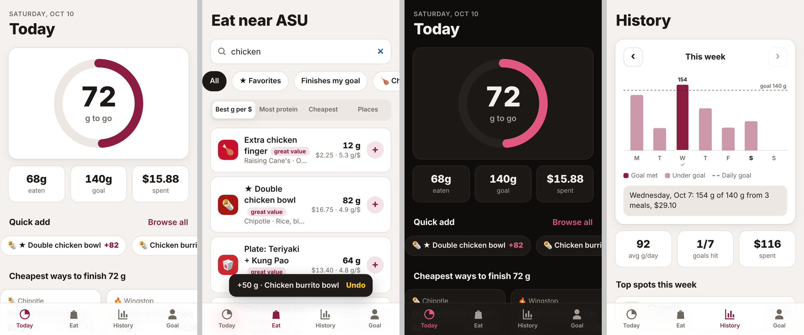

# Protein Devil: Tempe Protein Tracker

A phone app (installable PWA) that tells you how much more protein you need today when you're ordering DoorDash and Grubhub food near ASU's Tempe campus.



## What it does

- **Today:** a progress ring showing grams left, what you've eaten and spent, one-tap quick add for favorites and usual orders, and the cheapest menu items that would finish your goal.
- **Eat:** search 15 Tempe/ASU-area restaurants (Chipotle, Raising Cane's, Chick-fil-A, Panda Express, CAVA, Jersey Mike's, Pita Jungle, Original ChopShop, Cornish Pasty Co. and more). Filter by chicken, bowls, lean, under $10 or "finishes my goal", and sort by protein per dollar, most protein, cheapest or restaurant. Tap an item to pick servings, favorite it and log it.
- **History:** a weekly chart against your goal, with goals hit, average per day, money spent and top spots. Tap a bar for details.
- **Goal:** set it from body weight (0.7, 0.8 or 1.0 g per lb) or type grams. You can also log custom meals.
- Works offline, installs to your home screen, and keeps all data on your phone in localStorage.

## About the numbers

DoorDash and Grubhub don't offer a public menu or nutrition API, so protein and prices are **estimates**. Chain items follow the chains' published nutrition for a standard build, and local spots are estimated from typical portions. Prices are typical app menu prices before fees and tip. Edit `data.js` to correct or add items.

## Run it locally

```sh
python3 -m http.server 8000   # then open http://localhost:8000
```

## Host it on GitHub Pages

Settings → Pages → Build and deployment → Source: **Deploy from a branch**, Branch: `main`, folder `/ (root)`. The app will be at `https://<user>.github.io/tempe-protein-tracker/`. On your phone, open it and use "Add to Home Screen".
